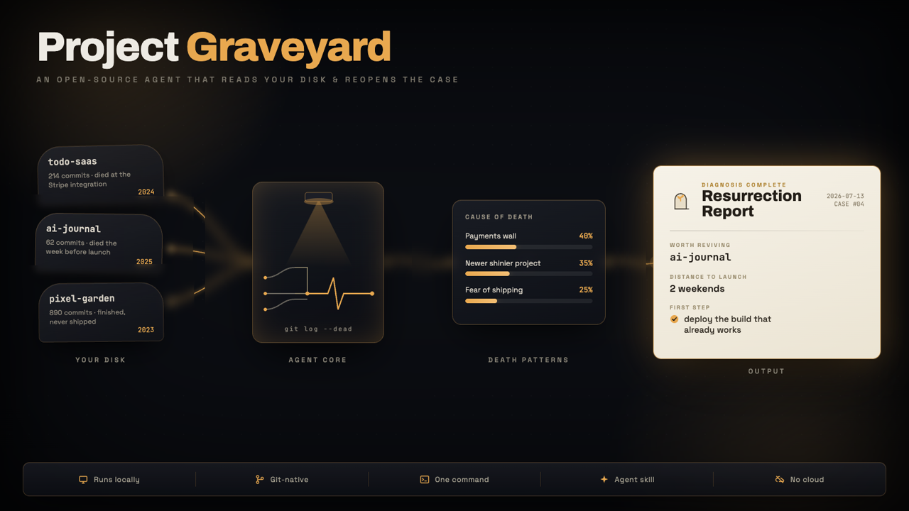
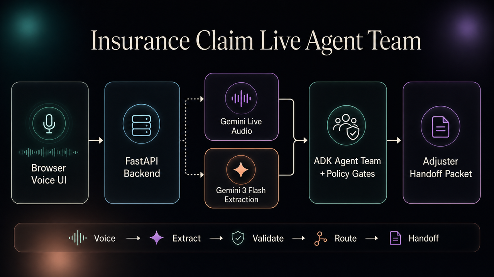
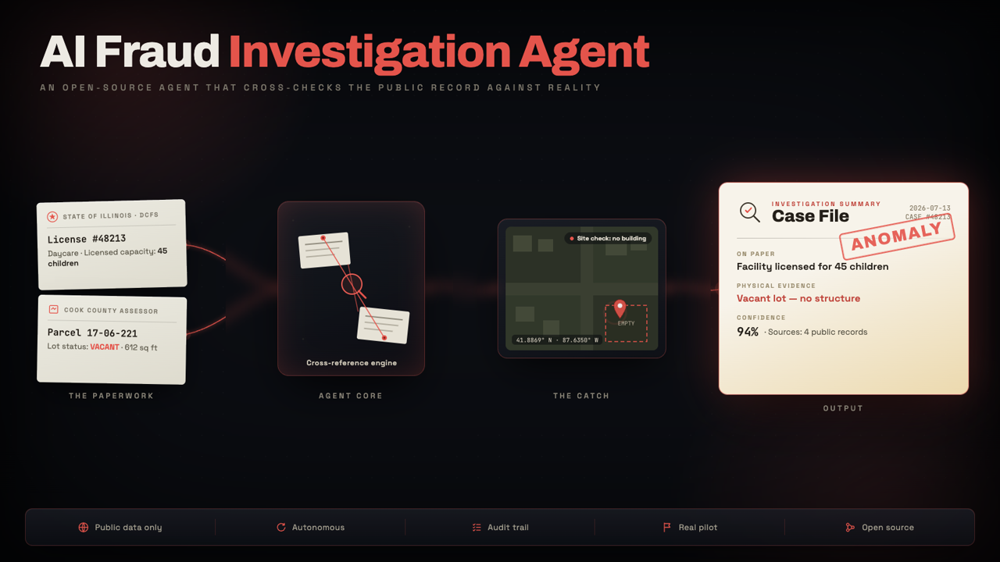
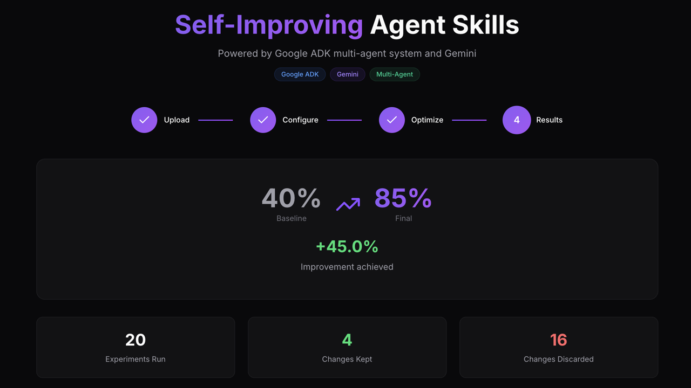
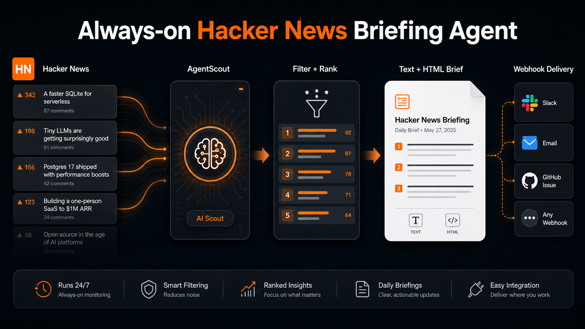

<div align="center">

# Awesome LLM Apps（超全 LLM 应用合集）

**100+ 开源 AI 智能体、Agent Skills 与 RAG 应用。全部手写、端到端实测通过、Apache-2.0 许可。**

克隆即用、可以上线、可以商用 —— 100% 免费开源

支持 Claude、Gemini、GPT、DeepSeek、Llama、Qwen 及其他开源模型。

**[Unwind AI 图文教程](https://www.theunwindai.com)** · **[快速开始](#-立刻跑一个)** · **[浏览全部模板](#-浏览全部模板)**

**[English](README.md)** · **中文**


<a href="https://trendshift.io/repositories/9876" target="_blank">
  
</a>

<br>

</div>

<table>
  <tr>
    <td width="33.3%" align="center">
      <a href="agent_skills/project-graveyard/"></a>
      <sub><b>Project Graveyard（项目墓地）</b></sub>
    </td>
    <td width="33.3%" align="center">
      <a href="voice_ai_agents/insurance_claim_live_agent_team/"></a>
      <sub><b>保险理赔实时语音团队</b></sub>
    </td>
    <td width="33.3%" align="center">
      <a href="advanced_ai_agents/single_agent_apps/ai_fraud_investigation_agent/"></a>
      <sub><b>AI 欺诈调查智能体</b></sub>
    </td>
  </tr>
  <tr>
    <td align="center">
      <a href="agent_skills/self-improving-agent-skills/"></a>
      <sub><b>自我进化的智能体技能</b></sub>
    </td>
    <td align="center">
      <a href="advanced_ai_agents/multi_agent_apps/ai_home_renovation_agent"></a>
      <sub><b>AI 家装改造智能体</b></sub>
    </td>
    <td align="center">
      <a href="always_on_agents/always_on_hn_briefing_agent/"></a>
      <sub><b>常驻 HN 简报智能体</b></sub>
    </td>
  </tr>
</table>

> 本文档为中文翻译版，若与英文版存在出入，请以 [README.md](README.md) 为准。

## 🚀 立刻跑一个

10 秒钟，给你的编码智能体加一项新技能：

```bash
npx skills add https://github.com/Shubhamsaboo/awesome-llm-apps/tree/main/agent_skills/project-graveyard
```

然后问它：*"为什么我的副业项目总是做不完？"*

或者 30 秒克隆仓库、跑起任意一个智能体：

```bash
git clone https://github.com/Shubhamsaboo/awesome-llm-apps.git
cd awesome-llm-apps/starter_ai_agents/ai_travel_agent
pip install -r requirements.txt
streamlit run travel_agent.py
```

> 📬 每周都有新模板上线。[在 Unwind AI 订阅，直接送到邮箱](https://www.theunwindai.com)。

## 📂 浏览全部模板

### 🧩 Agent Skills（智能体技能）

*给你的编码智能体装上新能力：一条命令安装，一句大白话使用。每个技能都附带真实代码，并通过安全扫描与评测 CI 门禁。兼容 Claude Code、Codex、Cursor 等编码智能体。[浏览全部技能 →](agent_skills/)*

*   [⚰️ Project Graveyard · 项目墓地](agent_skills/project-graveyard/) - 翻出你所有半途而废的副业项目，逐个说清它们是怎么"死"的，并帮你挑出值得回头做完的那一个
*   [👁️ First Reader · 第一位读者](agent_skills/first-reader/) - 模拟真实读者通读你的草稿，告诉你他们在哪儿失去兴趣、在哪儿停止阅读、读完记住了什么，而且一个字都不改
*   [🔭 Scope Creep Detector · 范围蔓延探测器](agent_skills/scope-creep-detector/) - 检查一个 diff 是否长超出了它声明的意图，并建议哪些该保留、哪些该拆出去、哪些需要给出理由
*   [🏺 Commit Archaeologist · 提交考古学家](agent_skills/commit-archaeologist/) - 从引入该代码的提交、后续修改、共同变更和意图线索中，重建某个文件或某段代码当初为什么存在
*   [🩺 Dependency Doctor · 依赖医生](agent_skills/dependency-doctor/) - 给依赖清单做体检：给标准库钉版本、过时的 backport、未固定版本的条目、重复约束、已被撤回（yanked）的发布
*   [🧠 Advisor Orchestrator Worker · 顾问-编排-执行](agent_skills/advisor-orchestrator-worker/) - Meta Loop 模式：Claude Fable 5.1 当顾问，GPT-6 Astra 当编排者，Gemini 3.8 Flash 当执行者
*   [🎙️ Thinking Out Loud · 边说边想](agent_skills/thinking-out-loud/) - 把你的一段口述还原成可快速扫读的简报：模型的猜测被单独隔离标注，你中途改口的地方会被标出来
*   [♾️ Self-Improving Agent Skills · 自我进化技能](agent_skills/self-improving-agent-skills/) - 用 Gemini 和 ADK 自动优化智能体技能

### 🛠️ 独立应用与工具

*独立 Web 应用、创意工具、浏览器扩展，以及面向日常流程的智能体剧本（playbook）。*

*   [✏️ Excaliflow - 手绘风格流程图，箭头实时流动](advanced_llm_apps/excaliflow/) - 在 Excalidraw 风格的画布上画系统架构和 AI 智能体流程，箭头带流动动画，还能导出视频
*   [🪡 Needle - 一种新的查找方式](advanced_llm_apps/needle/) - 按语义搜索网页并高亮最有说服力的那句原文，Chrome 扩展，由 TypeSafe Jev 驱动
*   [🌀 Ripple - 改一处，找出还要改哪些](advanced_llm_apps/ripple/) - 你在 Google Doc 里编辑时，找出相关联的不一致之处并给出修改建议，基于 TypeSafe Jev 与 Gemini
*   [📺 Take Back Your TV · 把电视夺回来](advanced_llm_apps/take-back-your-tv/) - 给编码智能体一个文件，它就把智能电视满是广告的首页换成你自己的照片

### 🌱 入门级 AI 智能体

*单文件智能体，只要一个 API Key 就能跑 —— 最适合从这里开始。*

*   [🎙️ AI 博客转播客智能体](starter_ai_agents/ai_blog_to_podcast_agent/) - 把任意博客链接变成一期有旁白的播客节目
*   [❤️‍🩹 AI 分手疗愈智能体](starter_ai_agents/ai_breakup_recovery_agent/) - 一支智能体小队，陪你走出分手后的情绪漩涡
*   [📊 AI 数据分析智能体](starter_ai_agents/ai_data_analysis_agent/) - 用大白话向任意 CSV 或 Excel 文件提问
*   [🩻 AI 医学影像智能体](starter_ai_agents/ai_medical_imaging_agent/) - 用 Gemini 对 X 光和扫描影像做诊断分析
*   [😂 AI 表情包生成智能体（浏览器版）](starter_ai_agents/ai_meme_generator_agent_browseruse/) - 靠驱动真实浏览器做表情包，而不是调图像 API
*   [🎵 AI 音乐生成智能体](starter_ai_agents/ai_music_generator_agent/) - 一句提示词进，一条 MP3 出
*   [🛫 AI 旅行智能体（本地 & 云端）](starter_ai_agents/ai_travel_agent/) - 生成个性化的逐日旅行行程
*   [💸 AI x402 付费智能体](starter_ai_agents/ai_x402_paying_agent/) - 自带钱包的智能体，为需要的数据按次付费 —— 不需要 API Key
*   [✨ Gemini 多模态智能体](starter_ai_agents/multimodal_ai_agent/) - 视频分析加联网搜索，一个智能体全包
*   [🔄 Mixture of Agents · 智能体混合](starter_ai_agents/mixture_of_agents/) - 多个大模型各自作答，再由一个模型汇总出最佳答案
*   [📊 xAI 金融智能体](starter_ai_agents/xai_finance_agent/) - 由 Grok 驱动的实时股票分析
*   [🔍 OpenAI 研究智能体](starter_ai_agents/openai_research_agent/) - 基于 OpenAI Agents SDK 的多智能体选题调研
*   [🕸️ 网页抓取智能体](starter_ai_agents/web_scraping_ai_agent/) - 你描述要提取什么，智能体去把它抓下来

### 🚀 进阶 AI 智能体

*带工具、记忆和多步推理的生产级智能体。*

*   [🏚️ 🍌 AI 家装改造智能体（Nano Banana Pro）](advanced_ai_agents/multi_agent_apps/ai_home_renovation_agent) - 你家的照片进，改造方案和写实级效果图出
*   [🧠 DevPulse AI - 多智能体信号情报](advanced_ai_agents/multi_agent_apps/devpulse_ai/) - 汇总并打分技术圈信号，产出每日情报摘要
*   [🔍 AI 深度研究智能体](advanced_ai_agents/single_agent_apps/ai_deep_research_agent/) - 用 OpenAI Agents SDK 和 Firecrawl 做全面的联网调研
*   [📊 AI 风投尽调智能体团队](advanced_ai_agents/multi_agent_apps/agent_teams/ai_vc_due_diligence_agent_team) - 基于 Gemini 3 的多智能体创业项目投资分析
*   [🔬 AI 研究规划与执行智能体（Google Interactions API）](advanced_ai_agents/single_agent_apps/research_agent_gemini_interaction_api) - 多阶段研究，带有状态的对话和自动生成的信息图
*   [🤝 AI 咨询顾问智能体](advanced_ai_agents/single_agent_apps/ai_consultant_agent) - 结合实时联网调研，给出市场分析和策略建议
*   [🏗️ AI 系统架构师智能体](advanced_ai_agents/single_agent_apps/ai_system_architect_r1/) - 用 DeepSeek R1 推理加 Claude 做架构评审
*   [💰 AI 财务教练智能体](advanced_ai_agents/multi_agent_apps/ai_financial_coach_agent/) - 个性化的预算、负债和储蓄分析
*   [🎬 AI 电影制作智能体](advanced_ai_agents/single_agent_apps/ai_movie_production_agent/) - 从一句话电影概念生成剧本初稿和选角想法
*   [📈 AI 投资智能体](advanced_ai_agents/single_agent_apps/ai_investment_agent/) - 基于 Yahoo Finance 数据的股票对比报告
*   [📡 财报电话会分析智能体](advanced_ai_agents/single_agent_apps/earnings_call_analyst_agent/) - 把 YouTube 上的财报电话会变成与播放进度同步的分析师工作台
*   [🏋️‍♂️ AI 健康健身智能体](advanced_ai_agents/single_agent_apps/ai_health_fitness_agent/) - 按你的目标定制饮食和训练计划
*   [🚀 AI 产品发布情报智能体](advanced_ai_agents/multi_agent_apps/product_launch_intelligence_agent) - 针对竞品发布的上市（GTM）情报
*   [🔍 AI 欺诈调查智能体](advanced_ai_agents/single_agent_apps/ai_fraud_investigation_agent/) - 交叉比对公开记录，标记出对不上号的机构
*   [🗞️ AI 记者智能体](advanced_ai_agents/single_agent_apps/ai_journalist_agent/) - 就任意选题做采访调研、写稿和编辑
*   [🧠 AI 心理健康智能体](advanced_ai_agents/multi_agent_apps/ai_mental_wellbeing_agent/) - 一支协同工作的智能体团队，产出心理健康支持方案
*   [📑 AI 会议智能体](advanced_ai_agents/single_agent_apps/ai_meeting_agent/) - 在你进会场之前，备好背景、行业洞察和策略要点
*   [🧬 AI 自我进化智能体](advanced_ai_agents/multi_agent_apps/ai_self_evolving_agent/) - 用 EvoAgentX 让智能体重写自己的工作流
*   [👨🏻‍💼 AI 销售情报智能体团队](advanced_ai_agents/multi_agent_apps/agent_teams/ai_sales_intelligence_agent_team) - 实时生成竞争型销售作战卡（battle card）
*   [🎧 AI 社媒资讯与播客智能体](advanced_ai_agents/multi_agent_apps/ai_news_and_podcast_agents/) - 把你信任的信息源整理成简报，并生成播客
*   [🌐 Openwork - 开源浏览器自动化智能体](https://github.com/accomplish-ai/coworker) <sub>↗ 外部链接</sub> - 操作真实浏览器的开源智能体
*   [🛡️ 带信任门禁的多智能体研究团队](advanced_ai_agents/multi_agent_apps/trust_gated_agent_team/) - 每个智能体都经过验证，每个动作都留在哈希链式审计轨迹里

### 🛰️ 常驻智能体（Always-on Agents）

*在后台按计划或按事件运行的智能体：持续观察不断变化的上下文，判断什么值得关注，并主动推送更新、产物或动作。*

*   [📰 常驻 Hacker News 简报智能体](always_on_agents/always_on_hn_briefing_agent/) - 定时巡查，把排好序的每日简报推到 Slack 或邮箱
*   [📡 Release Radar · 版本雷达智能体](always_on_agents/release_radar_agent/) - 盯着依赖的新版本，就破坏性变更、废弃、安全问题和主版本升级给你写简报

### 🤝 多智能体团队

*多个智能体协作，完成跨领域的复杂任务。*

*   [🧲 AI 竞品情报智能体团队](advanced_ai_agents/multi_agent_apps/agent_teams/ai_competitor_intelligence_agent_team/) - 基于竞品自己的官网，做出结构化的竞品拆解
*   [💲 AI 金融智能体团队](advanced_ai_agents/multi_agent_apps/agent_teams/ai_finance_agent_team/) - 20 行 Python 搭出一支金融分析师团队
*   [🎨 AI 游戏设计智能体团队](advanced_ai_agents/multi_agent_apps/agent_teams/ai_game_design_agent_team/) - 一群设计专家智能体，产出完整的游戏概念
*   [🧭 AG2 自适应研究团队](advanced_ai_agents/multi_agent_apps/agent_teams/ag2_adaptive_research_team/) - 基于 AG2 的智能体协作，带路由和兜底
*   [👨‍⚖️ AI 法律智能体团队（云端 & 本地）](advanced_ai_agents/multi_agent_apps/agent_teams/ai_legal_agent_team/) - 一整套法律班底，做检索、合同分析和策略建议
*   [💼 AI 招聘智能体团队](advanced_ai_agents/multi_agent_apps/agent_teams/ai_recruitment_agent_team/) - 从简历筛选到面试排期，全流程打通
*   [🏠 AI 房地产智能体团队](advanced_ai_agents/multi_agent_apps/agent_teams/ai_real_estate_agent_team) - 房源搜索、市场分析和购房建议
*   [👨‍💼 AI 服务代理公司（CrewAI）](advanced_ai_agents/multi_agent_apps/agent_teams/ai_services_agency/) - 一家数字代理公司，给你的软件项目做需求界定和排期规划
*   [👨‍🏫 AI 教学智能体团队](advanced_ai_agents/multi_agent_apps/agent_teams/ai_teaching_agent_team/) - 一支智能体教师团，为你搭出完整的学习路径
*   [💻 多模态编程智能体团队](advanced_ai_agents/multi_agent_apps/agent_teams/multimodal_coding_agent_team/) - 拍一张编程题的照片，拿到沙箱里验证过的解法
*   [✨ 多模态设计智能体团队](advanced_ai_agents/multi_agent_apps/agent_teams/multimodal_design_agent_team/) - 由 Gemini 驱动的专家小组做设计评审
*   [🎨 🍌 多模态 UI/UX 反馈智能体团队](advanced_ai_agents/multi_agent_apps/agent_teams/multimodal_uiux_feedback_agent_team/) - 给落地页提反馈，还自动生成一个改进版
*   [🌏 AI 旅行规划智能体团队](advanced_ai_agents/multi_agent_apps/agent_teams/ai_travel_planner_agent_team/) - 一个团队协作产出完整行程
*   [⚖️ LLM 评审团智能体团队](advanced_ai_agents/multi_agent_apps/agent_teams/llm_panel_agent_team/) - 三家厂商匿名盲审同一个 diff，然后互相辩论

### 🗣️ 语音 AI 智能体

*语音进、语音出，使用实时语音 API。*

*   [🗣️ AI 语音导览智能体](voice_ai_agents/ai_audio_tour_agent/) - 按你的位置、兴趣和节奏生成自助语音导览
*   [📞 客服语音智能体](voice_ai_agents/customer_support_voice_agent/) - 基于你自己的文档作答的语音客服
*   [🛡️ 保险理赔实时语音智能体团队](voice_ai_agents/insurance_claim_live_agent_team/) - 基于 Gemini 3.8 Live 的语音报案：一边写现场笔录，一边用摄像头看车损，一边画出事故示意图
*   [🔊 语音 RAG 智能体（OpenAI SDK）](voice_ai_agents/voice_rag_openaisdk/) - 向你的 PDF 提问，用耳朵听答案
*   [🎙️ 开源语音听写智能体（Wispr Flow 复刻）](https://github.com/akshayaggarwal99/jarvis-ai-assistant) <sub>↗ 外部链接</sub> - 开源听写，你说到哪儿它就在哪儿打字

### 🖼️ 生成式 UI 与智能体前端

*智能体渲染的不只是文字，还有可交互的 UI 组件：表单、卡片、图表、可编辑的方案。*

*   [🗂️ 生成式 UI 入门项目](generative_ui_agents/generative-ui-starter-project/) - 一块由聊天驱动的看板，你和智能体一起在上面干活
*   [🪙 AI 财务教练智能体](generative_ui_agents/ai-financial-coach-agent/) - 预算、储蓄和还债方案，以可交互卡片的形式呈现
*   [📊 AI 仪表盘画布智能体](generative_ui_agents/ai-dashboard-canvas-agent/) - 在聊天里描述一个仪表盘，图表就在实时画布上拼装出来
*   [🛠️ AI MCP 应用构建器](generative_ui_agents/ai-mcp-app-builder/) - 描述一个 MCP 应用，拿回一个可运行的沙箱实例
*   [✈️ MCP Apps 生成式 UI 展示](generative_ui_agents/mcp-apps-generative-ui-showcase/) - 能渲染真实交互界面的 MCP 应用，含航班搜索示例
*   [🎛️ AI Shadcn 组件生成器](generative_ui_agents/ai-shadcn-component-generator/) - 聊着聊着就得到可用于生产环境的 shadcn 组件
*   [🔍 AI 深度研究智能体](generative_ui_agents/ai-deep-research-agent/) - 每一次工具调用都渲染成一张实时工作区卡片的研究智能体

### 🎮 自主游戏智能体

*端到端玩游戏的智能体：推理、策略与操作。*

*   [🎮 AI 3D Pygame 智能体](advanced_ai_agents/autonomous_game_playing_agent_apps/ai_3dpygame_r1/) - DeepSeek R1 写 PyGame 代码，浏览器智能体实时把它跑起来
*   [♜ AI 国际象棋智能体](advanced_ai_agents/autonomous_game_playing_agent_apps/ai_chess_agent/) - 白方智能体对战黑方智能体，每步棋都经过合法性校验
*   [🎲 AI 井字棋智能体](advanced_ai_agents/autonomous_game_playing_agent_apps/ai_tic_tac_toe_agent/) - 两个不同的大模型一步一步对弈

### ♾️ MCP AI 智能体

*通过 Model Context Protocol 连接外部工具和数据的智能体。*

*   [♾️ 浏览器 MCP 智能体](mcp_ai_agents/browser_mcp_agent/) - 用自然语言通过 MCP 驱动真实浏览器
*   [🐙 GitHub MCP 智能体](mcp_ai_agents/github_mcp_agent/) - 用大白话浏览和分析任意仓库
*   [📑 Notion MCP 智能体](mcp_ai_agents/notion_mcp_agent) - 在终端里和你的 Notion 页面对话
*   [🌍 AI 旅行规划 MCP 智能体](mcp_ai_agents/ai_travel_planner_mcp_agent_team) - 基于 Airbnb 和 Google Maps 实时数据生成行程
*   [🔀 多 MCP 智能体路由器](mcp_ai_agents/multi_mcp_agent_router/) - 一群专家智能体，各自接在自己的 MCP 服务器上
*   [🔌 OpenAI 远程 MCP 工具桥](mcp_ai_agents/openai_remote_mcp_bridge/) - 把 OpenAI 的函数调用直接接到远程 MCP 服务器
*   [📦 依赖升级顾问](mcp_ai_agents/dependency_upgrade_advisor/) - 通过 MCP 读取库文档和 GitHub 仓库，看清一次升级会搞坏什么

### 📀 RAG（检索增强生成）

*从最简单的检索链，到智能体化、多数据源的检索管线。*

*   [🔥 基于 Embedding Gemma 的智能体 RAG](rag_tutorials/agentic_rag_embedding_gemma) - 用 EmbeddingGemma 和 Llama 3.2 做完全本地化的智能体 RAG
*   [🧐 带推理过程的智能体 RAG](rag_tutorials/agentic_rag_with_reasoning/) - 一边检索，一边看智能体逐步推理的过程
*   [📰 AI 博客搜索（RAG）](rag_tutorials/ai_blog_search/) - 基于 LangGraph 的博客内容智能体式搜索
*   [🔍 自主 RAG](rag_tutorials/autonomous_rag/) - GPT-4o 先从你的 PDF 里找答案，找不到就退回联网搜索
*   [🔄 Contextual AI RAG 智能体](rag_tutorials/contextualai_rag_agent/) - 托管式 RAG：几分钟内从数据存储（datastore）到可溯源问答
*   [🔄 纠正式 RAG（CRAG）](rag_tutorials/corrective_rag/) - 会给自己打分、并在作答前重试的检索
*   [📎 基于 Pydantic AI 的类型化智能体 RAG](rag_tutorials/agentic_typed_rag_pydanticai/) - 要么给出带精确引用的校验答案，要么在证据不足时直接拒答
*   [🐋 DeepSeek 本地 RAG 智能体](rag_tutorials/deepseek_local_rag_agent/) - 在你自己的文档上跑本地 DeepSeek 推理
*   [🤔 Gemini 智能体 RAG](rag_tutorials/gemini_agentic_rag/) - 用 Gemini Flash Thinking 做查询改写和联网兜底
*   [👀 混合检索 RAG（云端）](rag_tutorials/hybrid_search_rag/) - 关键词检索加向量检索，结果一起喂给 Claude
*   [🔄 Llama 3.1 本地 RAG](rag_tutorials/llama3.1_local_rag/) - 完全离线地和任意网页对话
*   [🖥️ 本地混合检索 RAG](rag_tutorials/local_hybrid_search_rag/) - 混合检索，全部组件都跑在你自己的机器上
*   [🧬 多模态智能体 RAG](rag_tutorials/multimodal_agentic_rag/) - 文本、PDF、图片、音频、视频，统一作答并给出引用
*   [🦙 本地 RAG 智能体](rag_tutorials/local_rag_agent/) - Llama 3.2 加 Qdrant，不需要任何 API Key
*   [🧩 RAG 即服务](rag_tutorials/rag-as-a-service/) - 不到 50 行代码搭出一个生产级 RAG 服务
*   [✨ 基于 Cohere 的 RAG 智能体](rag_tutorials/rag_agent_cohere/) - Command R7B 检索，带联网搜索兜底
*   [⛓️ 基础 RAG 链](rag_tutorials/rag_chain/) - 最小可用的检索管线，应用在医药研究场景
*   [📠 带数据库路由的 RAG](rag_tutorials/rag_database_routing/) - 自动把每个问题路由到正确的数据库
*   [🖼️ 视觉 RAG](rag_tutorials/vision_rag/) - 用 Embed-4 就图片和 PDF 页面提问
*   [🩺 RAG 故障诊断诊所](rag_tutorials/rag_failure_diagnostics_clinic/) - 系统化地找出你的 RAG 管线到底错在哪
*   [🕸️ 带引用的知识图谱 RAG](rag_tutorials/knowledge_graph_rag_citations/) - 多跳推理作答，来源可核验

### 💾 带记忆的 LLM 应用

*能跨会话记住对话内容和用户状态的智能体与聊天机器人。*

*   [💾 带记忆的 AI ArXiv 智能体](advanced_llm_apps/llm_apps_with_memory_tutorials/ai_arxiv_agent_memory/) - 会记住你研究方向的论文检索
*   [🛩️ 带记忆的 AI 旅行智能体](advanced_llm_apps/llm_apps_with_memory_tutorials/ai_travel_agent_memory/) - 记得你偏好的旅行助手
*   [💬 Llama3 有状态对话](advanced_llm_apps/llm_apps_with_memory_tutorials/llama3_stateful_chat/) - 基于 Llama 3 的会话持久化聊天
*   [📝 带个性化记忆的 LLM 应用](advanced_llm_apps/llm_apps_with_memory_tutorials/llm_app_personalized_memory/) - 跨多轮对话保持上下文的聊天机器人
*   [🗄️ 带记忆的本地 ChatGPT 复刻](advanced_llm_apps/llm_apps_with_memory_tutorials/local_chatgpt_with_memory/) - 完全本地运行，每个用户一份专属记忆
*   [🧠 共享记忆的多模型应用](advanced_llm_apps/llm_apps_with_memory_tutorials/multi_llm_memory/) - 不同的模型，共用同一份对话记忆

### 💬 Chat with X（与任意数据源对话）

*把任何数据源变成一个聊天界面。*

*   [💬 与 GitHub 对话（GPT & Llama3）](advanced_llm_apps/chat_with_X_tutorials/chat_with_github/) - 30 行 RAG 回答任意仓库的问题
*   [📨 与 Gmail 对话](advanced_llm_apps/chat_with_X_tutorials/chat_with_gmail/) - 直接向你的收件箱提问
*   [📄 与 PDF 对话（GPT & Llama3）](advanced_llm_apps/chat_with_X_tutorials/chat_with_pdf/) - 经典款，30 行 Python
*   [📚 与科研论文对话（ArXiv）（GPT & Llama3）](advanced_llm_apps/chat_with_X_tutorials/chat_with_research_papers/) - 用 GPT-4o 以对话方式探索 arXiv
*   [📝 与 Substack 对话](advanced_llm_apps/chat_with_X_tutorials/chat_with_substack/) - 和任意 newsletter 的历史归档聊天
*   [📽️ 与 YouTube 视频对话](advanced_llm_apps/chat_with_X_tutorials/chat_with_youtube_videos/) - 通过字幕向视频提问

### 🎯 LLM 优化工具

*在不损失质量的前提下，降低 token 用量、上下文长度和 API 成本。*

*   [🎯 Toonify Token 优化](advanced_llm_apps/llm_optimization_tools/toonify_token_optimization/) - 用 TOON 格式把 LLM API 成本降低 30-60%
*   [🧠 Headroom 上下文优化](advanced_llm_apps/llm_optimization_tools/headroom_context_optimization/) - 把 LLM API 成本降低 50-90%

### 🔧 LLM 微调

*面向开源模型的端到端微调配方。*

*   [🦥 Gemma 3 微调](advanced_llm_apps/llm_finetuning_tutorials/gemma3_finetuning/) - 用 Unsloth 做 4-bit LoRA，代码短小易读
*   [🦙 Llama 3.2 微调](advanced_llm_apps/llm_finetuning_tutorials/llama3.2_finetuning/) - 30 行完成微调，在 Colab 上免费跑

### 🧑‍🏫 AI 智能体框架速成课

*主流智能体框架的深度教程。*

*   [Google ADK 速成课](ai_agent_framework_crash_course/google_adk_crash_course/) - 入门智能体、结构化输出、工具（内置、函数、第三方、MCP）、记忆、回调、插件，以及多智能体模式。与模型无关。
*   [OpenAI Agents SDK 速成课](ai_agent_framework_crash_course/openai_sdk_crash_course/) - 入门智能体、函数调用、结构化输出、工具、记忆、评测、handoff（任务交接）、swarm 编排与路由逻辑。

---

<div align="center">

⭐ **[给仓库点个 Star](https://github.com/Shubhamsaboo/awesome-llm-apps/stargazers)**，新模板上线第一时间收到通知。

<sub>
<!-- Keep these links. Translations will automatically update with the README. -->
<a href="https://www.readme-i18n.com/Shubhamsaboo/awesome-llm-apps?lang=de">Deutsch</a> ·
<a href="https://www.readme-i18n.com/Shubhamsaboo/awesome-llm-apps?lang=es">Español</a> ·
<a href="https://www.readme-i18n.com/Shubhamsaboo/awesome-llm-apps?lang=fr">français</a> ·
<a href="https://www.readme-i18n.com/Shubhamsaboo/awesome-llm-apps?lang=ja">日本語</a> ·
<a href="https://www.readme-i18n.com/Shubhamsaboo/awesome-llm-apps?lang=ko">한국어</a> ·
<a href="https://www.readme-i18n.com/Shubhamsaboo/awesome-llm-apps?lang=pt">Português</a> ·
<a href="https://www.readme-i18n.com/Shubhamsaboo/awesome-llm-apps?lang=ru">Русский</a> ·
<a href="https://www.readme-i18n.com/Shubhamsaboo/awesome-llm-apps?lang=zh">中文</a>
</sub>

<sub>Apache-2.0 · 见 <a href="LICENSE">LICENSE</a> · Fork 它、上线它、卖掉它。</sub>

</div>
