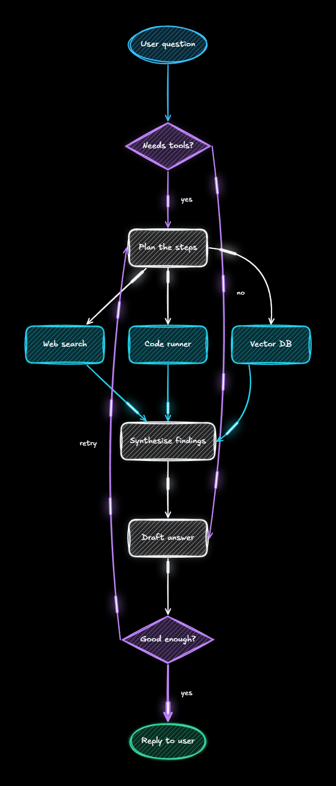

# ✏️ Excaliflow

**Hand-drawn diagrams with live animated flows.** Sketch out AI agents, RAG pipelines, or system architectures just like in Excalidraw, and watch data flow through your arrows in real time. Connect shapes, customize colors and sketch styles, and export a crisp 2x PNG or a 60fps video loop. Runs in a single HTML file with zero dependencies.

## Features

- **Hand-drawn look and feel.** Draw boxes, circles, decision diamonds, freehand sketches, and sticky notes using Excalidraw's hand-drawn fonts (`Excalifont`, `Virgil`, `Cascadia`) and sketch fills.
- **Live animated arrows.** Connect any two shapes and watch comets, pulses, neon streaks, or dashed streams travel along your arrows in order from start to finish.
- **Easy arrow editing.** Drag any arrow endpoint around the edge of a shape, pull the middle of an arrow to curve it, or double-click an arrow to straighten it.
- **Fast diagram building.** Press `Tab` or click a `+` port on any selected shape to add and connect the next step automatically, or drop a shape onto an existing arrow to split it in two.
- **Multi-canvas tabs & auto-save.** Work across multiple canvas tabs in the bottom tab dock or top-left canvas switcher—create new tabs (`+ New` / `+ Canvas`), fork/duplicate a diagram (`⧉`) to compare architectures side-by-side, step between tabs (`‹` / `›`), double-click to rename, and have every tab auto-saved to your browser.
- **Ready-made starter templates.** Load built-in diagrams for **AI Agent Swarm**, **RAG Pipeline**, **How Browsers Work**, and **Microservices** in one click.
- **Light & dark canvas + instant export.** Switch between a clean white canvas and a pitch-black neon canvas, then export a cropped 2x PNG, copy to clipboard, record a `.webm` video loop, or save and load `.excaliflow` / `.excalidraw` JSON files.
- **Text to Flow (Mermaid).** Paste a Mermaid flowchart (Templates → **From Mermaid text…**) and it is laid out automatically, with arrows routed around boxes. Scripts and AI coding agents can do the same with no UI, and `flow2gif.mjs` turns a `.mmd` file into a seamlessly looping GIF.

## How to Get Started

Requires **Node.js 18+** (or open `index.html` directly in any modern browser). Excaliflow has no external npm dependencies, so no install step is needed.

```sh
git clone https://github.com/Shubhamsaboo/awesome-llm-apps.git
cd awesome-llm-apps/advanced_llm_apps/excaliflow
npm start
```

Open **http://localhost:3000** in your browser.

## Text to Flow (Mermaid)



Write a Mermaid flowchart, for example [`examples/ai-agent.mmd`](examples/ai-agent.mmd):

```text
flowchart TD
  U([User question]) --> R{Needs tools?}
  R -->|no| A[Draft answer]
  R -->|yes| P[Plan the steps]
  P --> W[Web search] & C[Code runner] & V[Vector DB]
  W & C & V --> S[Synthesise findings]
  S --> A
  A --> G{Good enough?}
  G -- retry --> P
  G ==>|yes| O([Reply to user])
  style W stroke:#06b6d4
```

Excaliflow ranks the steps into layers, routes every arrow around the boxes it does not connect, and places labels clear of boxes. A loop is broken at the arrow that closes it in the order written, so `retry` arrows point back.

| Mermaid | Excaliflow |
| --- | --- |
| `flowchart` / `graph` + `TD` `TB` `BT` `LR` `RL` | layout direction |
| `id[text]`, `id(text)`, `id[[text]]`, `id[(text)]`, `id>text]` | box |
| `id{text}`, `id{{text}}` | diamond |
| `id((text))`, `id([text])` | oval |
| `-->`, `-.->`, `==>` (also `---`, `-.-`, `===`, `--x`, `--o`) | arrow, dashed arrow, thick arrow |
| `-->\|label\|`, `-- label -->` | label beside the arrow |
| `A --> B --> C`, `A & B --> C`, `;` | chains, fan-out and fan-in, several statements on a line |
| `style id stroke:#hex,color:#hex` | outline and text colour, snapped to the nearest palette colour |
| `"quoted text"`, `<br>`, `%% comment` | brackets inside labels, line breaks, comments |

`subgraph`, `classDef`, `class`, `linkStyle` and `click` are skipped with a warning; any other syntax error names its line. Every link draws as an animated arrow.

**From a script or an AI coding agent**, after the page loads:

```js
window.loadTextFlow(text)   // replaces the active canvas; returns warnings
window.textToFlow(text)     // { elements, warnings } without drawing
// options: { aspect: width / height, maxPerBand: layers per row (LR) or column (TD) }
```

**As a GIF**, with no UI (needs Chrome or Chromium, and ffmpeg on `PATH`):

```sh
node flow2gif.mjs examples/ai-agent.mmd examples/ai-agent.gif --dark --mode neon
```

Options: `--fps 25`, `--period 2` (seconds for one trip along every arrow; the GIF is exactly one trip, so it loops seamlessly), `--scale 1`, `--dark`, `--mode comets|pulses|neon|dashed`, `--page a4|a4-portrait` (fits the layout to the page and pads the image to exactly that shape), `--max-per-row N`. Set `CHROME=<path>` if the browser is not found.

## Keyboard Shortcuts

| Shortcut | Action |
| --- | --- |
| `V` or `1` | Select, move, resize shapes, or bend arrows |
| `H` or `Space + Drag` | Pan around the canvas |
| `R` or `2` | Rectangle |
| `D` or `3` | Diamond / Decision |
| `O` or `4` | Circle / Ellipse |
| `A` or `5` | Animated Arrow |
| `P` or `7` | Freehand Pen |
| `T` or `8` | Text |
| `N` or `9` | Sticky Note |
| `K` | Laser Pointer |
| `E` or `0` | Eraser |
| `Q` | Keep selected tool active (Tool Lock) |
| `Tab` | Add and connect the next shape |
| `Double-click` | Add a node on empty canvas, edit text, or straighten an arrow |
| `Alt / Option + Drag` | Duplicate selection while dragging |
| `⌥T` (`Alt + T`) | Create a new blank canvas tab |
| `⌥[` / `⌥]` (`Alt + [` / `]`) | Step to previous / next canvas tab |
| `⌥1` – `⌥9` (`Alt + 1..9`) | Switch directly to canvas tab 1–9 |
| `⌘Z` / `⇧⌘Z` | Undo / Redo |
| `⌘D` | Duplicate selection |
| `⌘\` | Show or hide the left style panel |

## Project Structure

```text
excaliflow/
|-- index.html            Complete single-file app (UI, sketch renderer, and animation loop)
|-- server.js             Zero-dependency local static server (http://localhost:3000)
|-- verify.js             Automated test suite for geometry, arrows, and interactions
|-- flow2gif.mjs          Mermaid file to looping GIF, headless (Chrome + ffmpeg)
|-- examples/             Mermaid examples and their GIFs
|-- package.json          Start and test scripts
`-- README.md
```

## Development

Run the automated verification checks:

```sh
npm test
```

Licensed under the repository's [Apache-2.0 license](../../LICENSE).
