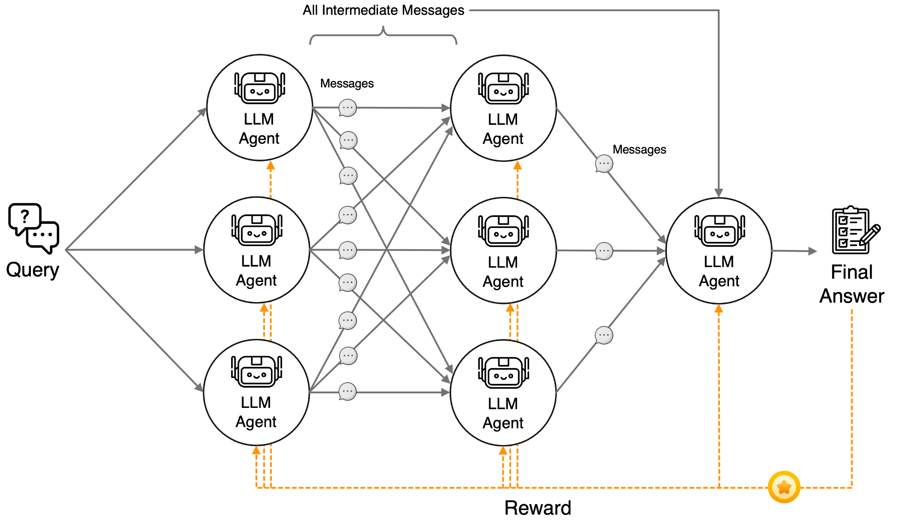

## 🧠 NeuroMAS: Train a Network of LLM Agents from One Final Reward

Train a whole team of LLM agents end to end, the way you train a neural network. No hand-written roles, no per-agent rewards: one frozen 0.6B backbone, one small LoRA adapter per agent, and a single reward for getting the final answer right.

- **Model**: Qwen3-0.6B (frozen backbone) with per-agent LoRA adapters
- **Method**: Joint REINFORCE from one shared terminal reward, with progressive growth
- **Benchmarks**: ARC, Navigate, MMLU (Algebra, Physics, Medicine), HumanEval
- **Paper**: [arXiv:2605.16757](https://arxiv.org/abs/2605.16757), STAI-X 2026, Paper Award Honorable Mention

### What you'll learn

- How to run many trainable agents on one model with swappable LoRA adapters
- How to train agents that communicate in text with REINFORCE
- Why agents can specialize without being assigned roles
- How to grow a trained small network into a larger one

## 💡 The idea

Most multi-agent systems are engineered by hand: someone writes a planner prompt, a critic prompt, and a verifier prompt, then wires them together. NeuroMAS treats the system as a **neural network whose neurons are language models**, and trains every agent jointly from one signal: whether the final answer was correct.

| Neural network | NeuroMAS |
|---|---|
| Neuron | Language-agent node (a shared backbone plus its own LoRA adapter) |
| Activation on an edge | A text message sent to a downstream node |
| Output layer | An output aggregation node that produces the answer |
| Loss | One terminal reward: was the answer correct? |
| Backpropagation | REINFORCE, since text is discrete |
| Widening a trained network | Progressive growth: NeuroMAS-3, then -5, then -7 |

The number in each name is the count of LLM calls per query.

<p align="center">
  
</p>

## 🔬 How it works

**1. One backbone, many agents.** All nodes share one frozen copy of the model, and each node owns a small LoRA adapter (rank 8). `AM` in `engine.py` stores every node's weights and swaps the active set in place, so adding an agent adds only adapter parameters.

**2. Role-free, structure-aware prompts.** A node is never told to be a planner or a critic. It sees only its position:

```text
[Network: 2-layer 2-2, 4 nodes | Layer 1/2, Position 2/2]

PROBLEM:
<the question>

Write a private message to each downstream node:
TO #1: <message for downstream node 1>
TO #2: <message for downstream node 2>
```

**3. Private message routing.** `parse_sections` splits `TO #k:` blocks so each downstream node receives only the text addressed to it. Routing is deterministic, so all of the learning happens inside the nodes.

**4. Joint REINFORCE from one reward.** The final answer is scored once, and every node trains on that same reward. Node `v` minimizes

```text
loss_v = -(reward - baseline_v) * mean_token_log_prob_v
```

where `baseline_v` is that node's exponential moving average of past rewards. There are no intermediate labels and no role-specific rewards. The whole learning rule is in `train_stage`.

**5. Progressive growth.** Train NeuroMAS-3 (topology `[1, 1]` plus an aggregator), then expand to `[2, 2]` and `[2, 2, 2]`. Inherited nodes keep their trained adapters and are frozen during the next stage, new nodes start with inactive adapters, and training continues with the same reward.

## 📊 Results from the paper

Accuracy (%) with Qwen3-0.6B, a 0.6B backbone:

| Method | ARC | Navigate | Algebra | Physics | Medicine | HumanEval | LLM calls |
|---|---|---|---|---|---|---|---|
| Direct prompting | 24.5 | 40.5 | 22.0 | 17.6 | 24.0 | 11.0 | 1 |
| GPTSwarm | 46.0 | 40.5 | 25.0 | 25.5 | 43.5 | 12.8 | 11 |
| Single-LLM RL (same parameter budget) | 46.0 | 42.0 | 29.0 | 24.5 | 43.0 | 17.7 | 1 |
| **NeuroMAS-3** | **56.5** | **45.5** | **39.0** | **44.1** | **48.0** | **30.5** | **3** |
| **NeuroMAS-7** | 53.5 | **51.0** | **42.0** | 39.2 | 43.5 | **31.7** | 7 |

NeuroMAS-3 and the single-agent control share the same backbone, objective, and number of trainable parameters. The gain comes from organizing those parameters into communicating agents.

## 🚀 Run it

**Requirements:** a single CUDA GPU with about 32 GB of VRAM. The backbone and datasets download automatically from the Hugging Face Hub. No API keys are needed.

```bash
pip install -r requirements.txt

# Fast smoke test: tiny budgets, verifies the pipeline end to end
SMOKE=1 python run.py --task navigate --size 3

# Train and evaluate NeuroMAS-3 on ARC-Challenge
python run.py --task arc --size 3

# Full progressive growth (3 -> 5 -> 7) on Algebra
python run.py --task algebra --size 7
```

`--task` is one of `arc`, `navigate`, `algebra`, `physics`, `medicine`, or `humaneval`. Results accumulate in `results/results.json`.

> **Security note.** The HumanEval reward executes model-generated code in a subprocess guarded only by a wall-clock timeout, which is not a security sandbox. Run code-generation experiments inside an isolated environment such as a container, VM, or restricted user.

## 🧪 Experiments to try

- **Use your own reward.** `Task.score` in `tasks.py` is the only place the objective appears, so any verifier you can write can train the whole team.
- **Add a benchmark.** Add a loader and one entry to `TASKS`.
- **Try another topology.** `fwd` accepts any list of layer widths.
- **Read the messages.** Print the outputs returned by `fwd` before and after training to see which communication patterns emerge.

## 📁 Files

| File | Role |
|---|---|
| `run.py` | Entry point: train and evaluate on one benchmark |
| `engine.py` | Adapter swapping, prompts, message routing, REINFORCE, progressive growth |
| `tasks.py` | Six benchmarks behind one `Task` interface |
| `llm.py` | Backbone loading, generation, per-token log-probs |
| `config.py` | Hyperparameters |

## 📚 Citation

Paper: [NeuroMAS: Multi-Agent Systems as Neural Networks with Joint Reinforcement Learning](https://arxiv.org/abs/2605.16757), *The First Conference on Statistics and Trustworthy AI for Cross (X)-Domain Acceleration (STAI-X 2026)*, Paper Award Honorable Mention.

Upstream repository: [haoranlustat/NeuroMAS](https://github.com/haoranlustat/NeuroMAS)

```bibtex
@inproceedings{lu2026neuromas,
  title     = {NeuroMAS: Multi-Agent Systems as Neural Networks with Joint Reinforcement Learning},
  author    = {Lu, Haoran and Fang, Luyang and Zhong, Wenxuan and Ma, Ping},
  booktitle = {The First Conference on Statistics and Trustworthy AI for Cross (X)-Domain Acceleration (STAI-X 2026)},
  year      = {2026}
}
```
