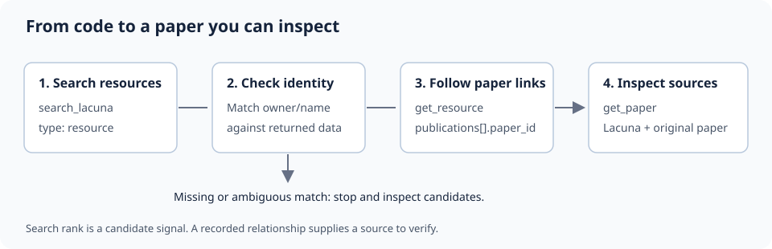

# Code-to-paper research with Lacuna MCP

Trace a public ML repository to its recorded research papers, then inspect the
sources. This example includes a skill for an existing coding agent and a runnable
Python tutorial for the retrieval workflow. It uses Lacuna's public MCP endpoint.

## Use with your coding agent

Connect this MCP URL in your agent's settings:

```text
https://lacuna.tiptreesystems.com/api/mcp
```

See the [server installation guide](https://github.com/tiptreesystems/lacuna-research-mcp#install)
for client-specific steps. Then install this skill from your clone:

```bash
npx skills add ./mcp_ai_agents/lacuna_code_to_paper
```

Ask: "Find the paper behind Dao-AILab/flash-attention. Show the recorded connection
to the repository and link the original paper."

## Run the retrieval workflow

From this directory, with [uv](https://docs.astral.sh/uv/getting-started/installation/)
installed:

```bash
uv run examples/code_to_paper.py
```

Or install `requirements.txt` with pip and run `python examples/code_to_paper.py`.
You need Python 3.11+ and internet access. No model API key or Lacuna account is
needed for the Python workflow. It sends public search terms and repository names;
it does not read or upload local code.

Open [the notebook](examples/code_to_paper.ipynb) for a self-contained tutorial,
architecture diagram, live comparison with one paper search, failure cases, and
an exercise. The Python controller uses explicit rules; it does not call an LLM.
The skill lets your existing agent apply the same evidence checks.



## What this teaches

1. Search resources rather than infer a repository's papers from a title match.
2. Resolve the intended repository before following any result.
3. Follow returned publication IDs and preserve the recorded relationship.
4. Return Lacuna and original-source URLs so the user can verify the attribution.

The default example retrieves the recorded `official_code_for` connection to
*FlashAttention: Fast and Memory-Efficient Exact Attention with IO-Awareness*.
Data and relationships can be incomplete or stale. A missing match stops the
workflow; it does not establish that no research exists. The notebook measures
one run's call counts and elapsed times, not general retrieval accuracy.

## Verify

```bash
uv run --with pytest --with pytest-asyncio --with mcp==2.3.0 \
  pytest -q -o asyncio_mode=auto tests/test_example.py
```

The tests cover repository identity, ambiguous and absent matches, both MCP
response formats, and tool errors. Run the notebook from a fresh kernel to verify
the live service separately.

## Source

Original example and skill from
[Lacuna Research MCP](https://github.com/tiptreesystems/lacuna-research-mcp),
maintained by Tiptree Systems. The included files retain their MIT license.
Lacuna also provides skills for prior-work checks and reading-list gaps.
